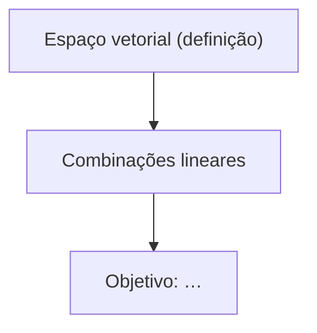

# Planejamento

Siga o CLAUDE.md (início de sessão, fidelidade). Este é o passo de maior alavanca: não tenha pressa. Pré-requisito: `sondagem.md`. Se ela não existir, diga isso e sugira `/sondar`.

## O método que o plano serve: dois princípios

**O método é um arco único: começar do que a pessoa tem como obviamente verdadeiro e avançar um passo de raciocínio por vez.** O cérebro não se compromete com um fato que talvez não seja seguro fixar. Se algo mais fundamental pode contradizê-lo depois, ele hesita e o fato não assenta. Essa hesitação, e não a quantidade de material, é o que faz lições não grudarem.

**Princípio i: verdades incondicionais primeiro.** Comece pelo chão: fatos que ela aceita *como são*, sem ressalvas nem "bem, geralmente…". Se precisa de condição, ainda não é uma verdade incondicional: cave mais fundo. Formas fortes:
- **Afirmações universais** ("todo X é Y", "nenhum X é Y"; o caso "TODO X é feito por meio de {____}").
- **Definições de verdade** (não listas vagas de propriedades).

Não force nenhuma das duas se não houver uma limpa. Termos:
- "Verdade incondicional" diz respeito a *como o fato é aceito*.
- "Axioma" diz respeito a *não derivar de nada*, ou seja, uma raiz.

Prefira "verdade incondicional" e reserve "axioma" para raízes genuínas.

**Princípio ii: "como eu poderia ter descoberto isso?"** Fatos parecem arbitrários quando não há motivo visível para serem assim. Torne cada passo motivado:
- Qual é o problema central que nos leva por esse caminho?
- Por que tentar *essa* fórmula, *essa* manipulação?

O produto transforma proposições desconectadas em proposições conectadas. A referência é 3Blue1Brown: nada surge do nada.

## Planejar

- Delimite o campo **a partir das fontes**: os conceitos centrais, os princípios de base de verdade, os enquadramentos padrão, as armadilhas comuns. Onde sua visão do campo estiver turva, verifique, seja nas fontes ou na web com referência. O que não vier das fontes leva a marca `[sem fonte · NN%]`.
- Quais verdades incondicionais sustentam o objetivo? Quais delas a pessoa já tem (sondagem + grafo)? Construa a partir dali, nem abaixo nem acima.
- **Árvore mínima**: nada que ela já tenha é reensinado, nada fora do caminho é ensinado, e a derivação até o objetivo é tão curta quanto o assunto permitir.
- Qual é o caminho de descoberta motivada? Para cada trecho, decida entre:
  - **Socrático**: ela tenta descobrir antes da revelação. É o padrão quando ela consegue raciocinar até lá.
  - **Expositivo**: você narra a descoberta motivada. Use quando estiver fora do alcance do raciocínio a frio.
- **Teste as raízes:** cada nó tratado como fundacional é mesmo incondicional *para ela*, ou é um teorema disfarçado? Se deriva de algo mais simples, empurre para baixo.
- **Divida em lições:** cada lição cabe em uma sessão (normalmente 1 a 4 nós do mapa). Uma lição termina num ponto em que algo ficou de pé sozinho.

## mapa.md

O mapa é **um mapa, não um roteiro**: os nós são marcos estruturais (as verdades incondicionais embaixo, as estações principais, o objetivo no sorvedouro). O passo de raciocínio é a unidade fina, e um nó pode levar um ou cinco passos.

~~~markdown
# Mapa — <topico>
<!-- revisão N, AAAA-MM-DD -->

## Lições
| # | Nós | Arquivo |
|---|---|---|
| 01 | defs-espaco, combinacao | licoes/01-combinacoes.md |
~~~

- Slugs: `a-z 0-9 - _`, escolhidos uma vez e **permanentes**.
- `-->` quer dizer "a origem precisa ser entendida antes do destino".
- Sem subgraphs.
- Nós que ela já tem podem aparecer com a classe `jasabe`, para mostrar onde o plano se apoia.

## Apresentar, sempre antes de qualquer ensino

1. **A abordagem em prosa**, em poucas frases: o que vamos cobrir, em que ordem e por que assim, dada a borda dela.
2. O caminho para `mapa.md`. Não redesenhe o mapa na mensagem.

Pergunte se o plano está bom e **encerre o turno**. Não ensine no turno da apresentação. Se ela pedir mudanças, revise e apresente de novo.

## Replanejar

O mapa é uma hipótese sobre a pessoa. Quando o ensino revelar algo diferente (falta um fundamento, ela já tem algo que o plano previa ensinar, uma confusão mais funda), reescreva: incremente a revisão e preserve os slugs existentes. Replanejar no meio de `/ensinar` é normal e não exige reapresentar o plano.

No fim: atualize `TOPICO.md` (próxima lição = 01) e faça o fim de sessão do CLAUDE.md.
