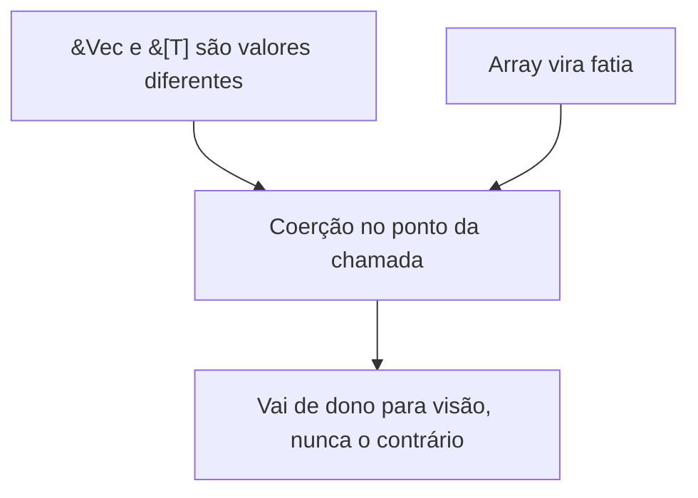

# Lição 01 — Coerção de referências na chamada
Nós do mapa: `coercao-deref` · Sessão: `ses_clippy_20261101_ensinar-01`

> [!IMPORTANT]
> Numa chamada de função, o compilador não exige que o argumento tenha exatamente o tipo do parâmetro. Quando o parâmetro é uma referência, ele converte o argumento por uma **coerção**, mas só quando a conversão vai de "dono" para "visão" (`&Vec<T>` → `&[T]`, `&String` → `&str`, `&[T; N]` → `&[T]`), e nunca ao contrário.

## Passo 1 — `&Vec<i32>` e `&[i32]` não são o mesmo valor <a id="m-01-1"></a>
Ponto de partida: `g(&a)` compila, com `a: [i32; 3]` e `fn g(v: &[i32])`, embora `&[i32; 3]` e `&[i32]` sejam tipos diferentes. "`&a` é só o endereço do dado" não explica isso, porque então `f(&a)`, com `fn f(v: &Vec<i32>)`, também compilaria, e ela não compila.

O que a diferença de tipos esconde, medido com rustc 1.97.1:

| tipo | bytes | o que é |
|---|---|---|
| `&Vec<i32>` | 8 | endereço do cabeçalho do `Vec` (ponteiro para os elementos, capacidade, tamanho) |
| `&[i32; 3]` | 8 | endereço dos elementos; o tamanho 3 está no tipo |
| `&[i32]` | 16 | par (endereço dos elementos, quantidade de elementos) |

[verificado por compilação, rustc 1.97.1] Os cabeçalhos do `Vec` e o par da fatia são valores diferentes. Passar `&w` onde se pede `&[i32]` exige que o compilador monte o par a partir do cabeçalho.

## Passo 2 — A coerção acontece no ponto da chamada <a id="m-01-2"></a>
Quando o parâmetro pede uma referência e o argumento é outra referência conversível, o compilador faz a conversão sozinho. Os casos que verificamos compilando:

- `&[i32; 3]` → `&[i32]` (o tamanho já está no tipo);
- `&Vec<i32>` → `&[i32]` (pelo `Deref` do `Vec`);
- `&String` → `&str` (pelo `Deref` da `String`).

[verificado por compilação] A relação com o `Deref` como mecanismo é [sem fonte · 90%]. O nome é "deref coercion".

## Passo 3 — A direção: de dono para visão <a id="m-01-3"></a>
O compilador só **tira** informação do que já existe. De `&Vec<i32>` ele tira o par (endereço dos elementos, tamanho) porque o cabeçalho está no endereço. De `&[i32]` ou de `&[i32; 3]` ele não consegue entregar um `&Vec<i32>`: no endereço só há elementos, sem capacidade e sem o cabeçalho, e fabricar um `Vec` não é uma conversão que ele faça. O mesmo vale para `&str` → `&String`:

```rust
fn q(s: &String) -> usize { s.len() }
q("clippy"); // erro E0308: expected `&String`, found `&str`
```

[verificado por compilação] `&String` onde se pede `&String` é o tipo exato e não precisa de coerção.

## Confusões encontradas e como foram reparadas
- **Encontrada** (S4, S5, 2026-10-30): "o argumento precisa ter exatamente o tipo do parâmetro". Falhou em `g(&w)` e `h(&st)`.
- **Reparo:** partiu da própria resposta certa `g(&a)`, que a regra exata não explicava; mostrou-se que `&Vec` e `&[i32]` têm representações diferentes; verificou-se em duas superfícies. Na V1 o raciocínio acertou o lado de `f(&a)` e deixou o lado de `g(&w)` sem resposta. Na V2 (outra superfície, `String`/`&str`) as quatro chamadas e as razões estavam certas (confiança 70). Fechada.

## Resumo: a cadeia

