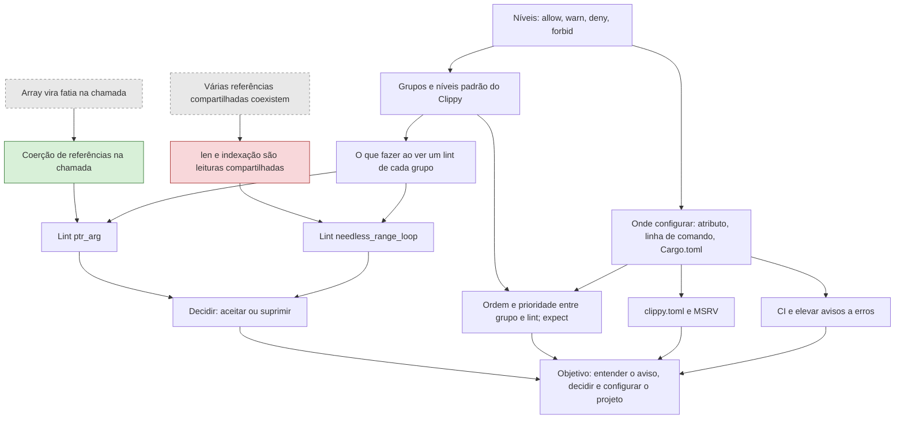

# Mapa — clippy
<!-- revisão 1, 2026-11-01; atualizado após a lição 01 -->

## Lições
| # | Nós | Arquivo |
|---|---|---|
| 01 | coercao-deref | licoes/01-coercao-deref.md |
| 02 | leituras-implicitas | licoes/02-leituras-implicitas.md |
| 03 | niveis-de-lint, grupos-padrao, postura-por-grupo | licoes/03-niveis-e-grupos.md |
| 04 | ptr-arg, needless-range-loop, aceitar-ou-suprimir | licoes/04-ler-dois-lints.md |
| 05 | escopos-de-supressao | licoes/05-escopos.md |
| 06 | prioridade-e-ordem | licoes/06-prioridade.md |
| 07 | clippy-toml | licoes/07-clippy-toml.md |
| 08 | ci-e-warnings, objetivo | licoes/08-ci-e-projeto.md |

## Notas do plano
- As lições 01 e 02 reparam as duas confusões abertas e vêm antes de qualquer lint que dependa delas.
- Fontes: `fontes/clippy-book/` (grupos, configuração, CI) e `fontes/catalogo-de-lints/` (cada lint). O que não vem delas leva `[sem fonte]`.
- Lição 06: `priority` em `[lints.clippy]`, `#[expect]` e a ordem do `#![allow]` depois do `#![warn(clippy::pedantic)]` não estão nas fontes locais. Verificar na documentação do Cargo e do rustc, com URL, antes de ensinar.
